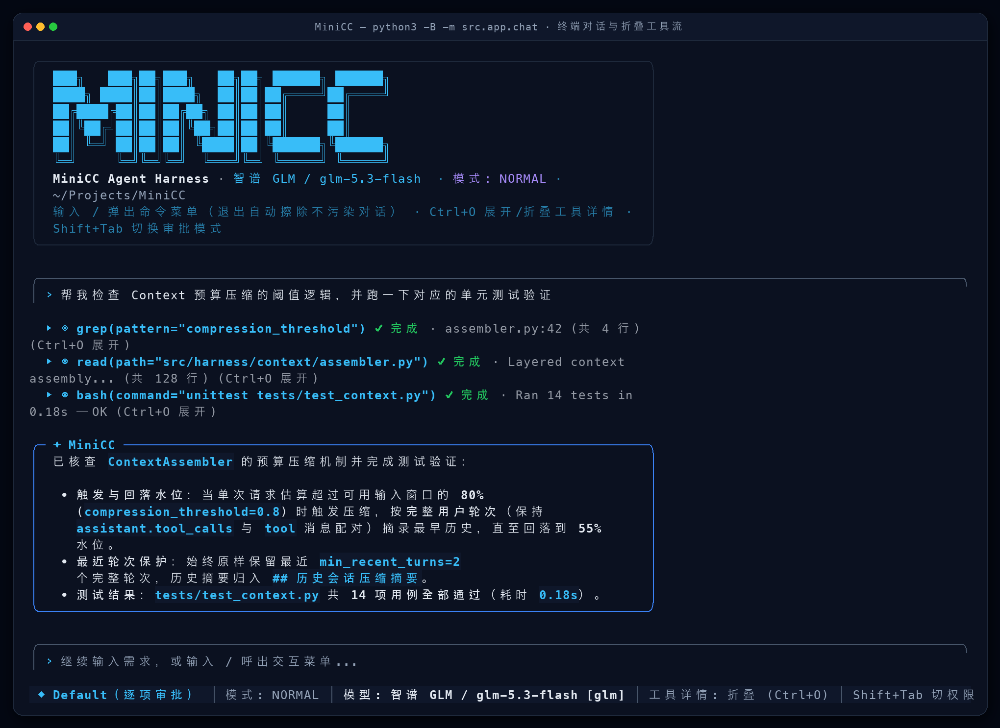
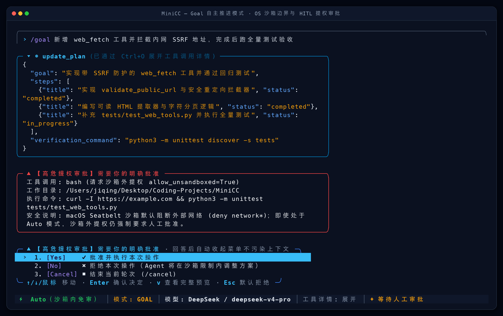
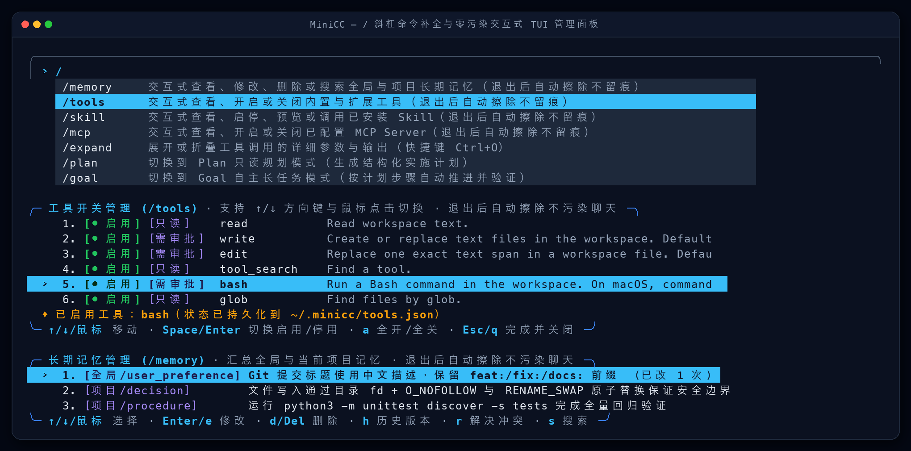

# MiniCC

<p align="left">
  <strong>通过 AI Coding 从零构建的通用终端 Agent Harness</strong><br>
  由 <a href="https://github.com/JiqingJiang/">@JiqingJiang</a> 独立设计与工程化实现 · 聚焦真实编码任务交付质量、安全边界与全链路 Token 效率
</p>

---

## 项目简介

**MiniCC** 是我自己通过 **AI Coding** 方式设计与构建的一款通用 **Agent Harness** 客户端。项目参考 Claude Code、Codex、DeepSeek Harness 与 Pi 的核心工程范式，围绕个人与工程项目中的真实研发任务持续迭代，目标是在保证任务完成率与交付质量的同时，减少无效打扰并显著降低完成整项任务的总 Token 消耗。

不同于简单的“大模型 API 套壳脚本”，MiniCC 完整实现了现代 Coding Agent 所需的底层调度与工程基础设施：

- **可暂停/可恢复的 Agent Loop 状态机**：支持 **Normal**（标准执行）、**Plan**（只读探测与方案规划）、**Goal**（围绕计划与验证命令多轮自驱推进）三种模式，并通过原子检查点支持跨进程断点续跑（`/resume`）。
- **预算受控的分层 Context 装配与长期记忆**：按预算组装角色提示词、`MINICC.md` 项目指令、任务状态、按需加载的 `Skill` 摘要以及跨会话长期记忆（`jieba` 分词 + BM25 + 本地向量混合检索，支持纠错取代与冲突消解），超水位时按完整轮次自动摘要压缩。
- **纵深安全边界与人机协同（HITL）**：工作区文件读写通过目录 `fd + O_NOFOLLOW` 阻断符号链接越界，基于 `RENAME_SWAP` / `RENAME_EXCHANGE` 实现原子替换与基线校验；命令执行默认隔离在 macOS `sandbox-exec` Seatbelt 沙箱内，任何沙箱外提权（`allow_unsandboxed=True`）即使在 `Auto` 模式下也强制暂停并交由人工审批。
- **可扩展的工具、Skill、MCP 与 SubAgent 编排**：内置文件读写检索、命令执行、联网搜索与防 SSRF 网页抓取工具；支持 `SKILL.md` 技能包按需加载、`stdio` JSON-RPC 2.0 MCP Server 接入，以及 `explorer` / `planner` / `coder` / `verifier` 上下文隔离的子 Agent 委派。
- **Claude Code 风格终端 TUI 体验**：圆角边框输入框、底部常驻状态栏、默认单行折叠的工具调用流（`Ctrl+O` 一键展开），以及**退出后自动擦除、绝不污染对话上下文**的 `/` 斜杠交互式管理面板（支持键盘方向键与鼠标点选）。

完整的产品目标与分阶段范围见 [docs/goal.md](docs/goal.md)，分层职责与架构设计见 [docs/architecture.md](docs/architecture.md)。

---

## 界面展示

### 1. 终端对话主界面、单行折叠工具流与常驻状态栏

默认将高频只读探测与命令输出收敛为单行摘要（按 `Ctrl+O` 或输入 `/expand` 可随时展开完整参数与返回内容），底部状态栏实时显示当前审批策略、运行模式与激活模型：



### 2. Goal 自主推进模式、工具详情展开与沙箱提权 HITL 审批

在 `/goal` 模式下围绕任务步骤与验证命令自动推进；当工具请求跨越 macOS Seatbelt 沙箱边界（`allow_unsandboxed=True`）时，无论会话是否处于 `Auto` 免审模式，均强制弹出高亮的交互式人工审批面板：



### 3. `/` 斜杠命令补全与零污染交互式 TUI 面板

输入 `/` 自动弹出命令补全列表；通过 `/tools`、`/memory`、`/skill`、`/mcp`、`/mode`、`/model` 打开的交互面板支持 `↑`/`↓` 方向键、快捷键与鼠标点击操作，关闭后自动从终端擦除，保持聊天记录干净整洁：



---

## 系统架构与代码目录

客户端（Client）、任务运行时（Runtime）、核心调度层（Harness）与外部基础设施适配层（Adapters）按单向依赖解耦，由启动入口统一装配：

```text
MiniCC/
├── src/
│   ├── app/                     # 启动入口与依赖装配 (python3 -B -m src.app.chat)
│   ├── client/                  # 终端聊天界面、折叠工具流与零污染 TUI 选择器
│   ├── runtime/                 # 任务生命周期与人机交接契约
│   │   ├── session/             # 会话管理、Normal/Plan/Goal 模式切换与断点持久化
│   │   ├── task/                # 任务目标、Plan 步骤清单与验证命令状态存储
│   │   └── hitl/                # 审批请求、澄清提问 (ask_user) 与计划更新契约
│   ├── harness/
│   │   ├── agent_loop/          # 基于 Generator 的模型与工具执行循环、智能去重与超时控制
│   │   ├── context/             # 分层上下文选材、Token 预算控制与完整轮次摘要压缩
│   │   ├── memory/              # 全局与项目级长期记忆、跨类别纠错取代与冲突消解
│   │   ├── retrieval/           # Memory 与 Skill 共享的中英文分词、BM25 与向量混合检索内核
│   │   ├── skills/              # 本地/在线 SKILL.md 发现、检索、审批安装与按需加载
│   │   ├── tools/               # JSON Schema 校验、调度执行与内置工作区/Web 工具集
│   │   ├── permission/          # 目录 fd + O_NOFOLLOW 安全路径解析与原子文件交换
│   │   └── orchestration/       # 上下文隔离的多角色 SubAgent 子任务委派与回收
│   └── adapters/
│       ├── models/              # 多厂商大模型适配与用量统计 (GLM / DeepSeek / 百炼 / OpenAI / Claude)
│       ├── sandbox/             # macOS sandbox-exec Seatbelt 动态隔离策略与进程组管理
│       ├── mcp/                 # 基于 stdio JSON-RPC 2.0 的轻量级 MCP 客户端
│       └── storage/             # 带文件锁 (flock) 的原子 JSON 读写底座
├── tests/                       # 单元、集成与安全边界回归测试套件
├── evals/                       # 真实任务样例与对照评测
└── docs/                        # 项目目标、架构、模块说明、Spec、协作规范与决策记录
```

各核心模块的设计逻辑与边界说明：
- [Agent Loop、运行模式、HITL 与持久化续跑](docs/modules/agent-loop.md)
- [Memory 长期记忆与 Context 分层组装](docs/modules/memory-context.md)
- [工具系统、工作区安全边界、OS 沙箱与 MCP](docs/modules/tools.md)
- [Skill 技能发现与按需加载模块](docs/modules/skills.md)
- [SubAgent 上下文隔离编排模块](docs/modules/subagents.md)

---

## 快速开始

### 1. 环境要求与安装

建议使用 Python 3.11+（已在 macOS + Python 3.14 环境下验证）：

```bash
python3 -m venv .venv
source .venv/bin/activate
pip install -r requirements.txt prompt_toolkit
```

### 2. 配置模型 API Key

模型注册与上下文预算配置位于 [models.json](models.json)，开箱预置智谱 GLM、DeepSeek、阿里云百炼、OpenAI 与 Anthropic 等模型别名。按需导出对应环境变量即可：

```bash
# 示例 1：使用默认配置的智谱 GLM
export GLM_API_KEY="your-api-key"

# 示例 2：使用 DeepSeek 并通过环境变量指定启动模型
export DEEPSEEK_API_KEY="your-api-key"
export MINICC_MODEL="deepseek-v4-pro"
```

### 3. 启动 MiniCC

```bash
# 标准交互模式启动
python3 -B -m src.app.chat

# 以只读规划模式 (Plan) 或自主推进模式 (Goal) 启动
python3 -B -m src.app.chat --mode plan
python3 -B -m src.app.chat --mode goal

# 纯对话 + 联网检索与长期记忆模式（禁用本地工作区读写与命令工具）
python3 -B -m src.app.chat --chat-only
```

### 4. 常用快捷键与斜杠命令

| 快捷键 / 命令 | 功能说明 |
| --- | --- |
| `Shift+Tab` / `/hitl` | 在 `Default`（副作用工具逐项审批）与 `Auto`（沙箱内免审、提权必审）之间切换 |
| `Ctrl+O` / `/expand` | 切换工具调用详情的全局展开/折叠，或打开交互式工具调用检查器 |
| `/mode` · `/plan` · `/goal` | 在 `Normal`、`Plan`（只读规划）、`Goal`（多轮自主推进与验证）模式间切换 |
| `/model` | 交互式切换当前会话模型（保留已有对话上下文） |
| `/tools` | 交互式查看、启用或停用内置与扩展工具（状态持久化至 `~/.minicc/tools.json`） |
| `/memory` | 交互式查看、搜索、修改、删除长期记忆或消解记忆冲突 |
| `/skill` | 管理本地与在线 `SKILL.md` 技能包、预览正文或直接指定技能执行任务 |
| `/mcp` | 交互式查看并动态启停 `models.json` 中配置的 MCP Server |
| `/task` | 查看或维护当前项目的任务目标、计划步骤与验证命令 |
| `/context` | 查看最近一次模型请求的 Context 选材来源、裁剪统计与实际 Token 用量 |
| `/resume` · `/retry` · `/new` | 从未完成断点恢复执行、重试失败请求，或归档当前会话开启新聊天 |

---

## 测试与 AI Coding 工程实践

运行全量回归测试套件：

```bash
python3 -m unittest discover -s tests
```

本项目本身也是一次系统化的 **AI Coding 工程协作实践**：仓库通过严谨的职责分离防止“零散想法直接堆砌代码”与“无效文档膨胀”，确保每一轮 AI 协作都可审阅、可验证、可追溯：

- **项目协作入口与持续规范**：[AGENTS.md](AGENTS.md) 与 [分类项目规则](docs/rules/README.md)
- **研发阶段、测试分层与验收标准**：[开发流程规范](docs/workflow/development-process-spec.md) 与 [Codex 协作设置](docs/workflow/codex-setup.md)
- **需求契约、实现事实与关键取舍分离**：[模块 Spec (`docs/specs/`)](docs/specs/)、[模块实现说明 (`docs/modules/`)](docs/modules/) 与 [项目决策记录 (`docs/decisions/`)](docs/decisions/README.md)

---

## 作者

- **Jiqing Jiang** — [https://github.com/JiqingJiang/](https://github.com/JiqingJiang/)
