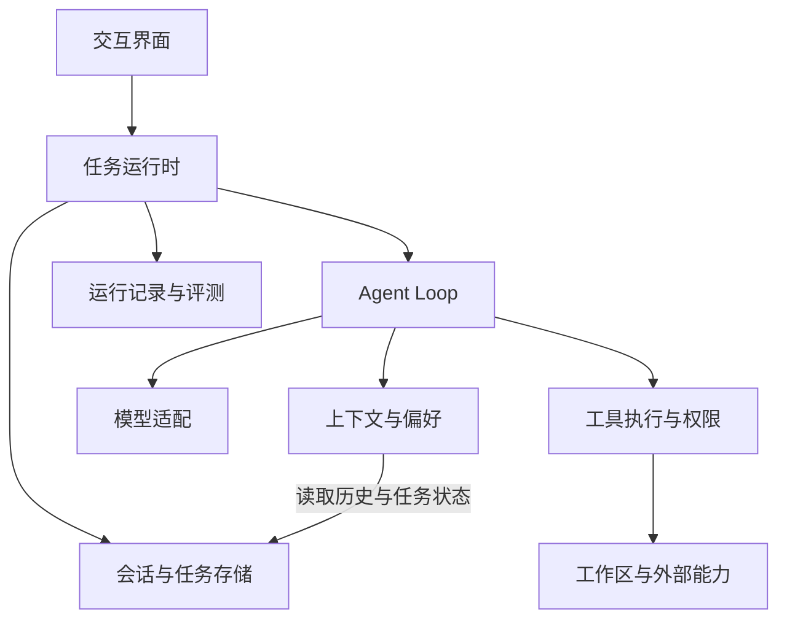

# 历史归档 · 目标与架构文档旧稿

状态：archived

2026-11-21，用户确认目录布局并要求精简 Agent 的常读上下文。旧稿合并保存在下方，原链接保留供追溯。当前入口见[项目目标](../../../../docs/goal.md)和[项目架构](../../../../docs/architecture.md)。

## `docs/project-goal.md`

~~~~markdown
# MiniCC 项目目标

## 最终目标

把 MiniCC 做成一个通用 Agent Harness 客户端。以 Codex、Claude Code、DeepSeek Harness、Pi 等产品为参照，逐步覆盖同类客户端能够完成的工作，达到同等的交付质量，并显著降低完成任务所需的总 Token。

长期希望 MiniCC 能接入企业的各类业务流程，承担其中的核心任务。企业能把目标、规则和推进条件交给 MiniCC，由它按流程执行，在需要人决定时交回控制权，最终给出可检查的结果。

## 现阶段范围

先用我在学校和个人项目里的真实任务验证通用能力。Codex 仍是我平时主要使用的工具，也是当前最直接的对照。企业系统集成、复杂办公任务和浏览器操作留待后续阶段讨论。

- **写代码、做项目。** 能了解已有项目，陪我讨论问题和方案，在我交代清楚任务后完成改动并验证结果。
- **润色、总结和整理。** 能保留我的原意，整理草稿和讨论内容。只有我明确要求沉淀成笔记时，才整理并交付笔记。
- **调研和制作演示稿。** 能围绕问题查资料、给出可核对的来源，并按要求交付能直接打开使用的 HTML 演示稿。
- **聊天、讨论人生和学习技术。** 能跟上多轮讨论，在我卡住时换一种方式讲解，并在我要求时帮我总结方法和收获。

## 期望的使用体验

- **旧聊天能接着聊。** 重新打开原来的聊天时，能延续讨论，知道已经确认的决定、做过的工作和还待解决的问题。
- **越用越了解我。** 在日常交流中逐渐了解我的偏好和做事方式，在相关的新聊天里自然用上。我可以纠正它的理解，也可以为这一次给出不同要求。
- **需要我决定时主动问。** 如果关键信息缺失，选择不同会明显改变交付结果，就在开始前弹出确认框，给出选项，也让我补充自己的答案。确认后继续执行。
- **任务明确时直接做。** 在已确认的范围内自行处理常规细节、解决可自行处理的问题，直到交付可用结果，或确实需要我提供信息、权限或决定时再停下来问。
- **离开聊天后继续执行。** 我切去做别的事时，长任务仍能推进。回来后能看到交付结果、当前进度，或需要我处理的具体问题。需要我决定的事项确认后，从已有进度接着做。
- **短任务响应快，长任务少打断。** 日常聊天和短任务优先保持响应快。长任务可以花更多时间，前提是它持续推进，并减少我回来纠正或补充指令的次数。

## 达成标准

用真实任务验收。同一类任务先看完成率、产物质量和需要我额外介入的次数，再比较从接到任务到交付的总 Token。任务涉及多轮交互、重试、后台执行或续做时，统计覆盖完整过程。能使用同一模型做对照时，优先固定模型和任务条件，检验 Harness 自身带来的差异。

验收覆盖短任务和长任务。短任务检查响应是否及时、结果能否直接用。长任务检查我离开后能否继续推进、遇到关键问题能否在合适的时机询问、回来后能否拿到可用产物。跨聊天的体验分别用重新打开旧聊天和带着相关偏好开启新聊天来验证。

首批对照任务从日常用法中选取。具体的 Token 降幅和响应时间门槛，结合首批实测结果确定。企业阶段的首个业务流程及其验收条件，在有真实场景后确定。
~~~~

## `docs/project-architecture.md`

~~~~markdown
# MiniCC 项目架构

**设计状态：候选架构。** 本文描述目标形态与首个可验证切片。当前仓库处于产品实现前的阶段，技术栈、界面形态和存储方案待定。

- [项目目标](project-goal.md)
- [代码目录组织](code-organization.md)
- 旧版架构讨论记录已归档；当前约定见[项目决策记录](../../README.md)。
- [模块文档入口](modules/README.md)

## 1. 架构由哪些使用场景驱动

| 使用场景 | 对架构的要求 |
| --- | --- |
| 写代码、做项目 | 能按工作区规则读写文件、执行验证、处理关键选择，并留下改动与验证证据。 |
| 润色、总结、学习和聊天 | 同一条消息入口能迅速返回首字。任务简单时直接回答，是否沉淀笔记遵循用户指令。 |
| 调研和制作 HTML 演示稿 | 能检索资料、保留可核对的来源并交付工作区产物。检索与生成都走同一任务生命周期。 |
| 回到旧聊天或另开新聊 | 旧聊天恢复历史与未完事项。新聊天按相关性使用可纠正的偏好。 |
| 切走后继续执行 | 执行生命周期独立于界面。界面重连时能看到进度、待确认事项和最终产物。 |
| 以更少 Token 完成同等质量的任务 | MiniCC 能控制或观测模型输入、工具结果与重试，并按整项任务汇总用量。 |

长期的企业流程可以复用任务执行、人工交接、权限和证据记录。首个真实业务场景确定后，再判断是否需要独立的工作流编排、远程运行和企业身份接入。

## 2. 逻辑模块与依赖



箭头表示逻辑调用或数据依赖。代码层通过各能力的接口接入存储、模型和外部工具，依赖规则见[代码目录组织](code-organization.md#4-依赖规则)。

| 逻辑模块 | 主要职责和边界 |
| --- | --- |
| **交互界面** | 打开会话、发送消息、接收增量输出、展示任务状态、提问和审批、打开产物。界面根据运行时状态渲染，断开连接时运行时独立推进。 |
| **任务运行时** | 创建和推进任务，管理取消、人工等待、恢复、失败与完成。运行时拥有任务的最终状态，Agent Loop 负责执行过程中的模型与工具迭代。 |
| **会话与任务存储** | 保存会话历史、任务状态、用户决定、待处理请求、已确认的工具结果和产物引用。为界面重连和任务恢复提供持久化记录。 |
| **上下文与偏好** | Context 为每次调用选择当前目标、相关历史、项目规则、偏好、Skill 和工具结果。Memory 管理可跨聊天复用的偏好及其来源、适用范围和修正。 |
| **模型适配** | 处理供应商的流式响应、工具调用格式、用量和错误，向核心暴露可用能力。MiniCC 在这一层之上选择模型和控制调用策略。 |
| **工具执行与权限** | 注册内置工具和 MCP 工具，校验调用，经过 Permission 判断后执行。Sandbox 约束受控执行环境的文件、进程与网络访问。 |
| **运行记录与评测** | 关联模型调用、工具结果、等待、重试、用量和产物证据。用真实任务衡量交付质量、用户介入、耗时和完整任务的 Token。 |

部署上，倾向**一个本地运行时和一个连接它的界面**。运行时内部按职责拆分，数据可先落在本地。界面关闭后是否继续取决于运行时自身的生命周期。终端、Web 或桌面界面以及本地通信方式由首个切片再定。

## 3. 一项任务如何运行

1. **接收输入。** 界面提交用户消息，运行时关联会话与工作区。简单聊天也可走同一执行入口，在模型直接回答后结束。已有任务等待回答时，界面把回答明确关联到对应请求。
2. **构建上下文。** Context 为本次调用装配目标、规则、相关历史、偏好、可见工具和必要的 Skill。完整日志和产物保留引用，模型按需读取。当前明确要求可以覆盖相应偏好，权限约束由执行边界独立判断。
3. **推进 Agent Loop。** Loop 调用模型。模型可以流式回复，以工具调用继续，或提出结构化问题。每次工具返回后，Loop 重新构建所需上下文，再推进一步。Plan 可以记录复杂任务的当前步骤。Goal 保存预期结果和完成条件。ReAct 是在观察后继续推理与行动的一种执行策略。
4. **处理人工决定和工具执行。** 需求澄清由运行时记录为待回答事项。工具调用先经过参数校验和 Permission 判断。若需要授权，运行时保存对应操作和授权范围，等待用户决定。允许后，由 Tool Executor 在相应隔离边界内执行。
5. **确认交付。** 运行时记录工作区产物、验证结果和完成状态。对于代码任务，用户能看到改动和验证结果。对于调研任务，用户能打开 HTML，并核对引用来源。

Hooks 可以在模型调用前后、工具执行前后、任务状态变化等稳定节点接入。涉及权限的决定仍由授权路径统一持有。SubAgent 将可独立验证的子任务交给单独运行的 Loop，返回结果及证据给父任务。Team 在此基础上协调共享任务、成员和结果，放到有真实协作需求的阶段验证。

## 4. 状态归属与恢复

### 数据由谁负责

| 数据 | 权威来源 | 如何使用 |
| --- | --- | --- |
| 会话及消息 | 会话存储 | 重开聊天时回看用户可见历史，为 Context 提供候选材料。 |
| 任务、Goal、Plan、当前状态 | 任务运行时负责变更，任务存储负责持久化 | 一段会话可包含多项任务。一项长任务可跨多次用户交互。计划步骤可以调整，目标与完成条件按用户确认的范围推进。 |
| 待回答问题、授权请求及决定 | 运行时管理请求生命周期，任务存储记录状态和结果 | 重连时可展示等待原因。回答关联请求和任务，处理重复提交时沿用同一决定。 |
| 偏好 | Memory | 保存来源和适用范围，支持纠正。Context 按当前任务检索。 |
| 模型输入 | Context 构建，运行记录保留必要的来源和用量信息 | 可以改变材料选择、摘要或压缩策略。历史与执行证据仍由各自的存储持有。 |
| 工具结果与产物 | 工具执行层产生，任务记录保存结果或引用 | 用于后续推理、恢复核对和用户验收。大体积日志及文件留在相应存储或工作区。 |

### 断开与恢复分别怎么处理

- **界面重连。** 界面读取当前任务快照，再从快照对应的位置接收后续更新。任务状态、待确认事项和最终输出应能在重连后恢复。流式片段可作为即时展示，关键状态以持久化记录为准。
- **人工等待。** 任务可从运行进入等待澄清或等待授权，再根据决定继续执行。记录请求、所关联的动作或问题、所处阶段以及决定。拒绝时，运行时可根据结果改走允许的路径，或把阻塞原因交还给用户。
- **运行时退出。** 首个切片建议先验证运行时存活时的继续执行与重连，并留下足够的任务记录。自动续做是进一步的能力。若进程在工具提交后、结果落盘前退出，恢复应先核对外部结果或等待人工决定，避免重复写入。

## 5. 自研与复用的边界

优先复用可替换的模型接入层，也可以评估现成的 Agent Loop。MiniCC 需要掌握任务状态、人工确认、上下文策略和用量观测。若候选 Loop 能公开材料装配、逐次用量和暂停恢复所需的控制点，可以按层接入。完整包装现有 Harness 适合快速验证产品交互，全自研适合关键控制点无法得到满足的情况，代价是承担更多协议兼容、流式与故障处理工作。 [Pi 模块说明](https://github.com/earendil-works/pi#packages)

界面与运行时的读写边界参考 Codex 的 Thread、Turn、Item 和流式通知。工具接入参考 MCP，权限判断与工具前后扩展点参考 Claude Agent SDK。扩展接口优先服务于已出现的需求，完整插件生命周期可在扩展需求明确后再定。 [Codex App Server](https://learn.chatgpt.com/docs/app-server) · [MCP 架构](https://modelcontextprotocol.io/docs/learn/architecture) · [Claude Agent SDK 权限](https://code.claude.com/docs/en/agent-sdk/permissions)

## 6. 演进与验收

| 阶段 | 候选范围 | 通过什么验证 |
| --- | --- | --- |
| 首个任务切片 | 单 Agent、一个模型适配、工作区工具、权限与隔离、人工交接、最小任务存储与用量记录。 | 用户交代一项真实仓库改动，关键选择能收到确认，切走后继续，回来能看到改动和验证。另用直接回答的短任务检查响应速度。 |
| 完善个人使用 | 旧聊续接、偏好纠正与按需注入、项目规则与 Skill、按需加载工具与长结果、带来源的调研和 HTML 交付。 | 新旧聊天分别验证，检查压缩或裁剪后是否遗漏确认的决定和验收条件。用真实调研任务打开 HTML 并核对来源。 |
| 扩展执行能力 | 按实际需求接入 MCP、Hooks、SubAgent、Team 和更强的恢复机制。 | 每一项新增能力用真实场景比较质量、完成时间、用户介入和总 Token。多 Agent 的用量汇总到父任务。 |
| 企业流程 | 按第一个真实流程确认任务入口、业务权限、人工交接、完成条件和审计需求。 | 用该流程的有效交付、人工接手与结果核查验收。 |

按完整任务与 Codex 对照。优先固定模型和任务条件，先看完成率、产物质量及用户介入，再比首字延迟、完成耗时和总 Token。用量汇总覆盖提问、压缩、重试、恢复与可能的子任务。缓存相关用量单列，避免和总输入重复计数。缺失的用量应标明，跨供应商的比较记录各自统计口径。

技术栈、首个界面的形态、运行时退出后的恢复要求、候选依赖和首批测量门槛，留到首个模块 spec 再确定。具体的实现、运行和验证方法随对应[模块文档](modules/README.md)维护。
~~~~

## `docs/code-organization.md`

~~~~markdown
# MiniCC 代码目录组织

**设计状态：候选目录。** 当前仓库已有 `docs/` 和 `.agents/` 等协作内容。下文的源码、测试和评测目录随实际能力落地建立。目录名描述职责，具体语言、框架、构建方式和持久化技术待首个实现切片确认。

- [项目架构](project-architecture.md)
- [项目目标](project-goal.md)
- [模块文档入口](modules/README.md)

## 1. 目录怎么从架构推导

[项目架构](project-architecture.md)按产品职责讲清楚一项任务由谁执行、保存和恢复。代码目录按实现边界组织，开发者可以直接找到 Agent Loop、Context、Permission 或 MCP 的实现。

一个逻辑模块可以有多个目录。例如，**工具执行与权限**覆盖工具分发、权限策略、隔离执行和 MCP 接入。一个能力也可能跨目录，例如 **HITL** 的等待状态在运行时，授权判定在 Permission，确认框在界面。任务状态只有一个写入入口，各目录围绕它各司其职。

## 2. 目标目录树

```text
MiniCC/
├── src/                         # 计划中的产品源码
│   ├── client/                  # 聊天、任务进度、确认交互、产物展示
│   ├── runtime/                 # 本地运行时入口与任务调度
│   │   ├── session/             # 会话记录、消息历史及其存储接口
│   │   ├── task/                # 任务状态、Goal、Plan、取消与恢复
│   │   └── hitl/                # 待回答事项、权限请求及其处理
│   ├── harness/                 # Agent 的执行机制
│   │   ├── agent-loop/           # 单 Agent 的模型与工具循环
│   │   ├── context/              # 上下文装配、选材、预算与压缩
│   │   ├── memory/               # 跨聊天偏好的读取、更新和纠正
│   │   ├── skills/               # Skill 发现、选择与按需加载
│   │   ├── tools/                # 工具定义、注册、分发与结果
│   │   │   └── builtin/          # 工作区文件、命令和其他内置工具
│   │   ├── permission/           # 操作授权判断与范围校验
│   │   ├── hooks/                # 生命周期事件和扩展回调
│   │   └── orchestration/        # 出现实际委派和团队场景时建立
│   │       ├── subagents/        # 子任务委派、执行与结果回收
│   │       └── teams/            # 共享任务与成员协调
│   ├── adapters/                 # 与供应商、协议和执行环境对接
│   │   ├── models/              # 模型供应商 API 与流式协议适配
│   │   ├── storage/             # 本地会话、任务、偏好与记录的落盘实现
│   │   ├── mcp/                 # MCP 客户端、能力发现与映射
│   │   ├── sandbox/             # 隔离执行环境的具体实现
│   │   └── telemetry/           # 运行记录的输出、聚合与导出
│   └── app/                     # 选择具体实现并组装运行时与入口
├── tests/                       # 跨模块集成和端到端行为验证
├── evals/                       # 真实任务样例、评测数据和对照方法
├── docs/                        # 目标、架构、约定及模块文档
│   ├── project-goal.md
│   ├── project-architecture.md
│   ├── code-organization.md
│   └── modules/
└── .agents/                     # 开发协作规则、工作流程与决策记录
```

`src/app/` 负责装配具体依赖，`src/runtime/` 持有产品运行状态与生命周期。MiniCC 在运行时加载的 Skill 由 `src/harness/skills/` 的机制管理。本仓库用于协作开发的流程位于 `.agents/skills/`。

## 3. 根据要改的能力找目录

| 能力或改动 | 从哪里开始 | 通常涉及的其他位置 |
| --- | --- | --- |
| Agent Loop、模型响应和工具结果如何迭代 | `src/harness/agent-loop/` | 模型错误或协议差异看 `src/adapters/models/`，任务级取消和恢复看 `src/runtime/task/`。 |
| Goal、Plan、ReAct | Goal 和 Plan 放在 `src/runtime/task/`。ReAct 的执行策略放在 `src/harness/agent-loop/`。 | 先按任务记录和单循环实现。出现多种确需切换的执行策略后，再从 Loop 中拆出策略实现。 |
| 记住并纠正用户偏好 | `src/harness/memory/` | 存储实现看 `src/adapters/storage/`，这次调用是否纳入偏好看 `src/harness/context/`。 |
| 减少重复历史、长日志和工具描述的 Token | `src/harness/context/` | 会话历史在 `src/runtime/session/`，对照样例和评价方法在 `evals/`。 |
| Skill、项目规则、Hooks | Skill 发现和加载看 `src/harness/skills/`，规则与输入装配看 `src/harness/context/`，生命周期扩展看 `src/harness/hooks/`。 | Hook 由相应事件的所有者调用，例如工具执行前由工具分发路径触发。 |
| 内置工具和 MCP | 工具注册与分发看 `src/harness/tools/`，协议接入看 `src/adapters/mcp/`。 | MCP 工具进入同一工具注册与授权路径。MCP 提供的资源可作为 Context 的候选输入。 |
| Permission、Sandbox | 授权策略看 `src/harness/permission/`，实际隔离看 `src/adapters/sandbox/`。 | 工具分发负责发起判断。需要人工批准时，任务运行时保存请求与恢复位置。 |
| HITL 和重连 | 待答事项在 `src/runtime/hitl/`，任务状态与恢复在 `src/runtime/task/`。 | 界面控件在 `src/client/`，持久化实现看 `src/adapters/storage/`。 |
| SubAgent 和 Team | `src/harness/orchestration/` 下的 `subagents/`、`teams/` | 复用单 Agent Loop。任务生命周期和父子关联由运行时管理，用量汇总到父任务。 |
| Token、耗时与任务评测 | 运行时关联任务和执行记录，模型适配提供逐次用量，`src/adapters/telemetry/` 负责输出记录。 | 可重复的任务及评测方法放在 `evals/`，阶段结论可写入对应模块的 `evaluation.md`。 |

## 4. 依赖规则

1. **启动入口装配依赖。** `app/` 选择具体模型、存储、执行环境和入口。运行时与 Harness 通过能力接口使用这些实现，接口优先放在消费能力的模块旁边。例如，模型流式调用接口放在 Loop 附近，任务存储接口放在任务模块，隔离执行接口放在工具执行一侧。
2. **界面通过运行时契约交互。** `client/` 提交请求、读取状态、接收更新。任务的转换规则放在 `runtime/task/`，读写存储由运行时及其依赖负责。
3. **运行时驱动 Harness。** 运行时提供任务输入、状态视图和执行依赖。Loop 返回可继续的结果、待处理事项或结束结果。Context 读取运行时提供的数据视图和 Memory 查询能力，任务状态由运行时更新，避免形成双向依赖。
4. **工具在统一边界执行。** 内置工具和 MCP 工具经过同一权限入口。Permission 返回判定，HITL 处理待用户决定的请求，Sandbox 落实本地进程的隔离约束。远端 MCP 操作的访问限制还取决于远端身份与权限。
5. **观测跟随实际执行。** 请求、失败、重试或子任务的用量记录使用同一任务关联。界面显示的任务状态来自运行时，`evals/` 使用运行记录和产物证据做对照。

文件先按职责放在最直接的位置。一组代码有独立状态、依赖或变更原因时，再拆目录或包。例如，更换模型供应商应主要改模型适配和装配位置，调整审批策略应主要改权限判断及其规则。出现需要跨多个目录同步修改的重复模式时，再回看模块接口。

## 5. 首个切片如何落地

首个真实代码任务优先建立实际用到的目录。界面接运行时，运行时有会话、任务和 HITL 的最小状态，Harness 提供 Agent Loop、Context、工作区工具和 Permission。模型、存储和 Sandbox 各接一个可用实现，同步记录逐次模型用量。首批集成验证覆盖「切走后能继续」「确认后能从已有进度恢复」「工作区改动附有验证结果」。

Memory、Skill、MCP、Hooks、SubAgent 和 Team 根据后续任务拉动建立。已有能力可以先用单文件承载，再随复杂度增长展开为目录。目标树中的后续位置用于讨论归属。

模块落地后，在 [`docs/modules/`](modules/README.md) 下按模块补齐当前边界、使用方式和验收方法。经确认的模块 spec 和评测记录也放在该模块目录。测试回答「行为是否正确」，评测回答「同样任务的质量、介入次数、耗时和 Token 是否改善」。
~~~~

## `docs/modules/README.md`

~~~~markdown
# 模块文档

模块开始形成后，在 `docs/modules/<模块名>/` 建文档。

| 文件 | 内容 |
| --- | --- |
| `README.md` | 当前实现、模块边界、流程与接口、运行方式，以及如何验证。可从[模块文档模板](_template.md)开始。 |
| `spec.md` | 用户已经同意整理成 spec 的本轮设计。写范围、行为、约束、验收与评测计划。 |
| `evaluation.md` | 需要复查的功能测试与深度评测记录，附版本、命令、结果和已知限制。按模块实际需要建立。 |

运行和实现细节在模块目录维护。需要追溯某个设计取舍时，从模块文档链接到项目决策记录。
~~~~

## `docs/modules/_template.md`

~~~~markdown
# <模块名称>

## 目标与边界

<模块服务的用户任务、与最终目标的关系、入口和已确认的范围。>

## 当前设计与行为

<调用关系、核心流程、数据、接口、状态变化和错误行为。具体内容以实际实现为准。>

## 运行与体验

<前置条件、启动命令、样例输入和用户可以体验的步骤。>

## 功能验收与评测

<已有检查入口、代表性用例和指标。关联版本或评测记录，标明待验证事项。>

## 相关决策

<链接已存在的 spec 和有助于理解来由的决策记录。>
~~~~
